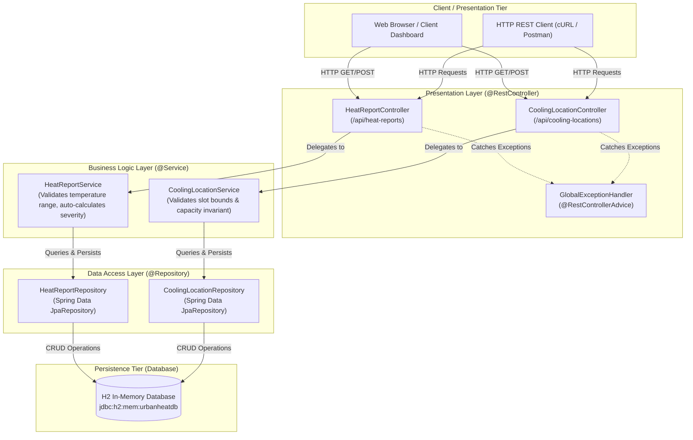

# Activity: Design and Develop a Basic Spring Boot Application
**Course Module:** Spring Boot Framework – Part 1  
**Project Topic:** Urban Heat Hotspot & Cooling Planner (`urbanheat`)  
**Development Stack:** Java 21, Spring Boot 4.1.1, Apache Maven 3.9+, Spring Data JPA, Hibernate, In-Memory H2 Database, Spring Boot Test / JUnit 5, Mockito  

---

## 1. Application Name & Problem Description

### Application Name
**Urban Heat Hotspot & Cooling Planner** (`urbanheat`)

### Problem Description
Dense urban metropolitan centers experience the **Urban Heat Island (UHI)** effect, where artificial concrete, asphalt pavements, and high vehicular density trap heat, creating localized microclimates that are significantly hotter than surrounding rural or suburban zones. During peak summer waves, temperatures in unshaded asphalt corridors routinely exceed $40^\circ\text{C}$, posing severe health risks (heat exhaustion, stroke) to vulnerable populations, outdoor laborers, and pedestrians.

### Solution Overview
The **Urban Heat Hotspot & Cooling Planner** is a resilient municipal web service that:
1. **Tracks Urban Heat Hotspots:** Ingests thermal field readings from IoT sensor nodes and citizen municipal reports, validating temperatures within realistic bounds ($-50^\circ\text{C}$ to $70^\circ\text{C}$) and categorizing thermal severity (`HIGH`, `MEDIUM`, `LOW`).
2. **Coordinates Municipal Cooling Hubs:** Manages emergency cooling shelters, public libraries, and community air-conditioned shelters, tracking total capacity and real-time available relief slots.
3. **Ensures Data Integrity & Architecture:** Adheres strictly to a decoupled **Three-Tier Architecture** (Presentation, Business, Data Access) with robust business rule enforcement in the Service layer.

---

## 2. Architecture Diagram

The application strictly implements the **Three-Layer / Three-Tier Architecture** prescribed by Spring Boot best practices:




### Request Flow Summary:
$$\text{Client} \longrightarrow \text{Controller (Presentation)} \longrightarrow \text{Service (Business)} \longrightarrow \text{Repository (Data Access)} \longrightarrow \text{H2 Database (Data)}$$

---

## 3. Domain Model / Classes

The application identifies two core domain entities relevant to the urban thermal resilience topic:

### Entity 1: `HeatReport`
Represents an observed thermal hotspot report within the metropolitan area.

| Attribute | Data Type | Constraints | Description |
| :--- | :--- | :--- | :--- |
| `id` | `Long` | `@Id`, `@GeneratedValue(IDENTITY)` | Primary key identifier |
| `location` | `String` | `@NotBlank` | Urban zone, intersection, or street name |
| `temperature` | `Double` | `@NotNull`, `@Min(-50)`, `@Max(70)` | Temperature reading in Celsius |
| `severity` | `String` | `LOW`, `MEDIUM`, or `HIGH` | Heat urgency classification |

```java
package com.example.urbanheat.model;

import jakarta.persistence.Entity;
import jakarta.persistence.GeneratedValue;
import jakarta.persistence.GenerationType;
import jakarta.persistence.Id;
import jakarta.persistence.Table;
import jakarta.validation.constraints.Max;
import jakarta.validation.constraints.Min;
import jakarta.validation.constraints.NotBlank;
import jakarta.validation.constraints.NotNull;

@Entity
@Table(name = "heat_reports")
public class HeatReport {

    @Id
    @GeneratedValue(strategy = GenerationType.IDENTITY)
    private Long id;

    @NotBlank(message = "Location is required")
    private String location;

    @NotNull(message = "Temperature is required")
    @Min(value = -50, message = "Temperature must be between -50 and 70 Celsius")
    @Max(value = 70, message = "Temperature must be between -50 and 70 Celsius")
    private Double temperature;

    private String severity;

    public HeatReport() {}

    public HeatReport(Long id, String location, Double temperature, String severity) {
        this.id = id;
        this.location = location;
        this.temperature = temperature;
        this.severity = severity;
    }

    // Getters and Setters
    public Long getId() { return id; }
    public void setId(Long id) { this.id = id; }
    public String getLocation() { return location; }
    public void setLocation(String location) { this.location = location; }
    public Double getTemperature() { return temperature; }
    public void setTemperature(Double temperature) { this.temperature = temperature; }
    public String getSeverity() { return severity; }
    public void setSeverity(String severity) { this.severity = severity; }
}
```

---

### Entity 2: `CoolingLocation`
Represents a municipal shelter, air-conditioned facility, or hydration hub.

| Attribute | Data Type | Constraints | Description |
| :--- | :--- | :--- | :--- |
| `id` | `Long` | `@Id`, `@GeneratedValue(IDENTITY)` | Primary key identifier |
| `name` | `String` | `@NotBlank` | Name of the cooling facility |
| `address` | `String` | `@NotBlank` | Street address / physical location |
| `capacity` | `int` | `@Min(0)` | Total shelter visitor capacity |
| `availableSlots`| `int` | `@Min(0)` | Real-time remaining unoccupied slots |

```java
package com.example.urbanheat.model;

import jakarta.persistence.Entity;
import jakarta.persistence.GeneratedValue;
import jakarta.persistence.GenerationType;
import jakarta.persistence.Id;
import jakarta.persistence.Table;
import jakarta.validation.constraints.Min;
import jakarta.validation.constraints.NotBlank;

@Entity
@Table(name = "cooling_locations")
public class CoolingLocation {

    @Id
    @GeneratedValue(strategy = GenerationType.IDENTITY)
    private Long id;

    @NotBlank(message = "Name is required")
    private String name;

    @NotBlank(message = "Address is required")
    private String address;

    @Min(value = 0, message = "Capacity must be non-negative")
    private int capacity;

    @Min(value = 0, message = "Available slots must be non-negative")
    private int availableSlots;

    public CoolingLocation() {}

    public CoolingLocation(Long id, String name, String address, int capacity, int availableSlots) {
        this.id = id;
        this.name = name;
        this.address = address;
        this.capacity = capacity;
        this.availableSlots = availableSlots;
    }

    // Getters and Setters
    public Long getId() { return id; }
    public void setId(Long id) { this.id = id; }
    public String getName() { return name; }
    public void setName(String name) { this.name = name; }
    public String getAddress() { return address; }
    public void setAddress(String address) { this.address = address; }
    public int getCapacity() { return capacity; }
    public void setCapacity(int capacity) { this.capacity = capacity; }
    public int getAvailableSlots() { return availableSlots; }
    public void setAvailableSlots(int availableSlots) { this.availableSlots = availableSlots; }
}
```

---

## 4. Project & Package Structure

```
urbanheat/
├── pom.xml                                   # Maven dependency & build descriptor
├── src/
│   ├── main/
│   │   ├── java/
│   │   │   └── com/example/urbanheat/
│   │   │       ├── UrbanheatApplication.java # Spring Boot main entrypoint (@SpringBootApplication)
│   │   │       ├── HelloController.java      # Basic greeting REST endpoint
│   │   │       ├── config/
│   │   │       │   └── DataInitializer.java  # Auto seed data runner (CommandLineRunner)
│   │   │       ├── controller/               # Presentation Layer
│   │   │       │   ├── HeatReportController.java
│   │   │       │   └── CoolingLocationController.java
│   │   │       ├── dto/                      # Data Transfer Objects
│   │   │       │   └── ErrorResponse.java
│   │   │       ├── exception/                # Centralized Exception Handling
│   │   │       │   └── GlobalExceptionHandler.java
│   │   │       ├── model/                    # Domain Entities
│   │   │       │   ├── HeatReport.java
│   │   │       │   └── CoolingLocation.java
│   │   │       ├── repository/               # Data Access Layer
│   │   │       │   ├── HeatReportRepository.java
│   │   │       │   └── CoolingLocationRepository.java
│   │   │       └── service/                  # Business Logic Layer
│   │   │           ├── HeatReportService.java
│   │   │           └── CoolingLocationService.java
│   │   └── resources/
│   │       ├── application.properties        # Application configuration & H2 console setup
│   │       └── static/                       # Client presentation dashboard
│   │           ├── index.html                # Light/Dark Theme SPA Dashboard
│   │           ├── css/style.css             # Vanilla CSS custom design system
│   │           └── js/app.js                 # Frontend REST integration & reactivity
│   └── test/
│       └── java/
│           └── com/example/urbanheat/
│               ├── UrbanheatApplicationTests.java
│               ├── controller/
│               │   ├── HeatReportControllerTest.java
│               │   └── CoolingLocationControllerTest.java
│               └── service/
│                   ├── HeatReportServiceTest.java
│                   └── CoolingLocationServiceTest.java
```

---

## 5. Controller Code (Presentation Layer)

The Presentation Layer exposes HTTP REST endpoints, validates incoming JSON payloads using `@Valid`, and delegates all operations to the Service layer without containing business logic.

### `HeatReportController.java`
```java
package com.example.urbanheat.controller;

import com.example.urbanheat.model.HeatReport;
import com.example.urbanheat.service.HeatReportService;
import jakarta.validation.Valid;
import org.springframework.web.bind.annotation.*;

import java.util.List;

@RestController
@RequestMapping("/api/heat-reports")
public class HeatReportController {

    private final HeatReportService service;

    public HeatReportController(HeatReportService service) {
        this.service = service;
    }

    @GetMapping
    public List<HeatReport> getAllReports() {
        return service.getAllReports();
    }

    @PostMapping
    public HeatReport addReport(@Valid @RequestBody HeatReport report) {
        return service.addReport(report);
    }
}
```

### `CoolingLocationController.java`
```java
package com.example.urbanheat.controller;

import com.example.urbanheat.model.CoolingLocation;
import com.example.urbanheat.service.CoolingLocationService;
import jakarta.validation.Valid;
import org.springframework.web.bind.annotation.*;

import java.util.List;

@RestController
@RequestMapping("/api/cooling-locations")
public class CoolingLocationController {

    private final CoolingLocationService service;

    public CoolingLocationController(CoolingLocationService service) {
        this.service = service;
    }

    @GetMapping
    public List<CoolingLocation> getAllLocations() {
        return service.getAllLocations();
    }

    @PostMapping
    public CoolingLocation addLocation(@Valid @RequestBody CoolingLocation location) {
        return service.addLocation(location);
    }
}
```

---

## 6. Service Code (Business Logic Layer)

The Business Layer encapsulates domain validation, severity threshold calculation, and capacity invariant enforcement before interacting with the database.

### `HeatReportService.java`
```java
package com.example.urbanheat.service;

import com.example.urbanheat.model.HeatReport;
import com.example.urbanheat.repository.HeatReportRepository;
import org.springframework.stereotype.Service;

import java.util.List;

@Service
public class HeatReportService {

    private static final List<String> VALID_SEVERITIES = List.of("LOW", "MEDIUM", "HIGH");

    private final HeatReportRepository repository;

    public HeatReportService(HeatReportRepository repository) {
        this.repository = repository;
    }

    public List<HeatReport> getAllReports() {
        return repository.findAll();
    }

    public HeatReport addReport(HeatReport report) {
        // Business Rule: Location Validation
        if (report.getLocation() == null || report.getLocation().isBlank()) {
            throw new IllegalArgumentException("Location is required");
        }

        // Business Rule: Temperature Range Validation
        if (report.getTemperature() == null ||
                report.getTemperature() < -50 ||
                report.getTemperature() > 70) {
            throw new IllegalArgumentException("Temperature must be between -50 and 70 Celsius");
        }

        // Business Rule: Automatic Severity Calculation
        if (report.getSeverity() == null || report.getSeverity().isBlank()) {
            if (report.getTemperature() >= 40) {
                report.setSeverity("HIGH");
            } else if (report.getTemperature() >= 30) {
                report.setSeverity("MEDIUM");
            } else {
                report.setSeverity("LOW");
            }
        } else {
            String upper = report.getSeverity().trim().toUpperCase();
            if (!VALID_SEVERITIES.contains(upper)) {
                throw new IllegalArgumentException("Severity must be LOW, MEDIUM, or HIGH");
            }
            report.setSeverity(upper);
        }

        return repository.save(report);
    }
}
```

### `CoolingLocationService.java`
```java
package com.example.urbanheat.service;

import com.example.urbanheat.model.CoolingLocation;
import com.example.urbanheat.repository.CoolingLocationRepository;
import org.springframework.stereotype.Service;

import java.util.List;

@Service
public class CoolingLocationService {

    private final CoolingLocationRepository repository;

    public CoolingLocationService(CoolingLocationRepository repository) {
        this.repository = repository;
    }

    public List<CoolingLocation> getAllLocations() {
        return repository.findAll();
    }

    public CoolingLocation addLocation(CoolingLocation location) {
        if (location.getName() == null || location.getName().isBlank()) {
            throw new IllegalArgumentException("Name is required");
        }

        if (location.getAddress() == null || location.getAddress().isBlank()) {
            throw new IllegalArgumentException("Address is required");
        }

        // Business Rule: Capacity & Slots Invariant
        if (location.getCapacity() < 0 ||
                location.getAvailableSlots() < 0 ||
                location.getAvailableSlots() > location.getCapacity()) {
            throw new IllegalArgumentException("Invalid capacity or available slots");
        }

        return repository.save(location);
    }
}
```

---

## 7. Repository Code (Data Access Layer)

Data persistence is abstracted through Spring Data JPA interfaces extending `JpaRepository`.

### `HeatReportRepository.java`
```java
package com.example.urbanheat.repository;

import com.example.urbanheat.model.HeatReport;
import org.springframework.data.jpa.repository.JpaRepository;
import org.springframework.stereotype.Repository;

@Repository
public interface HeatReportRepository extends JpaRepository<HeatReport, Long> {
}
```

### `CoolingLocationRepository.java`
```java
package com.example.urbanheat.repository;

import com.example.urbanheat.model.CoolingLocation;
import com.example.urbanheat.repository.JpaRepository; // Spring Data JPA
import org.springframework.data.jpa.repository.JpaRepository;
import org.springframework.stereotype.Repository;

@Repository
public interface CoolingLocationRepository extends JpaRepository<CoolingLocation, Long> {
}
```

---

## 8. REST Endpoints Specification

| Method | Endpoint | Request Body | Response Status | Response Body | Description |
| :--- | :--- | :--- | :--- | :--- | :--- |
| `GET` | `/api/heat-reports` | None | `200 OK` | `[HeatReport, ...]` | Retrieves all recorded heat hotspot records |
| `POST` | `/api/heat-reports` | `{ "location", "temperature", "severity" }` | `200 OK` / `400 Bad Request` | `HeatReport` / `ErrorResponse` | Creates and persists a new thermal reading |
| `GET` | `/api/cooling-locations` | None | `200 OK` | `[CoolingLocation, ...]` | Retrieves all registered cooling shelters |
| `POST` | `/api/cooling-locations` | `{ "name", "address", "capacity", "availableSlots" }` | `200 OK` / `400 Bad Request` | `CoolingLocation` / `ErrorResponse` | Registers a municipal cooling shelter |

### Example 1: Submit Heat Report (POST)
**Request:**
```bash
curl -X POST http://localhost:8080/api/heat-reports \
  -H "Content-Type: application/json" \
  -d '{
    "location": "Metro Transit South Terminal",
    "temperature": 43.5,
    "severity": null
  }'
```
**Response (`200 OK`):**
```json
{
  "id": 6,
  "location": "Metro Transit South Terminal",
  "temperature": 43.5,
  "severity": "HIGH"
}
```

### Example 2: Retrieve All Heat Reports (GET)
**Request:**
```bash
curl -s http://localhost:8080/api/heat-reports
```
**Response (`200 OK`):**
```json
[
  { "id": 1, "location": "Downtown Plaza (Concrete Core)", "temperature": 42.5, "severity": "HIGH" },
  { "id": 2, "location": "Industrial Logistics Park", "temperature": 38.0, "severity": "MEDIUM" },
  { "id": 3, "location": "Eastside Asphalt Corridor", "temperature": 41.2, "severity": "HIGH" },
  { "id": 4, "location": "Greenbelt Riverfront Park", "temperature": 27.5, "severity": "LOW" },
  { "id": 5, "location": "Midtown Commercial Market", "temperature": 36.8, "severity": "MEDIUM" }
]
```

---

## 9. Business Rules Implemented in the Service Layer

The project implements the following distinct business rules residing strictly within `HeatReportService` and `CoolingLocationService`:

1. **Automatic Severity Classification by Temperature:**
   - When a heat report is submitted without an explicit severity level, the system dynamically calculates and assigns the severity based on scientific thermal impact:
     - **$\text{Temperature} \ge 40^\circ\text{C}$** $\rightarrow$ `HIGH` (Emergency alert level)
     - **$30^\circ\text{C} \le \text{Temperature} < 40^\circ\text{C}$** $\rightarrow$ `MEDIUM` (Elevated heat warning)
     - **$\text{Temperature} < 30^\circ\text{C}$** $\rightarrow$ `LOW` (Normal / ambient urban baseline)

2. **Physically Realistic Temperature Bounds Checking:**
   - The reported temperature must strictly adhere to the closed interval $[-50^\circ\text{C}, 70^\circ\text{C}]$. Any reading outside this boundary triggers an immediate `IllegalArgumentException` ("Temperature must be between -50 and 70 Celsius").

3. **Cooling Shelter Capacity Invariant Enforcement:**
   - For all registered cooling facilities, available relief slots must be non-negative ($0 \le \text{availableSlots}$) and cannot exceed the facility's total certified capacity ($\text{availableSlots} \le \text{capacity}$). Any violation is rejected with `IllegalArgumentException` ("Invalid capacity or available slots").

---

## 10. Test Cases Specification

| Test Case ID | Test Description | Input Data | Expected Output | Actual Output | Status |
| :--- | :--- | :--- | :--- | :--- | :--- |
| **TC-01** | Auto-calculate `HIGH` severity for extreme heat | `location`: "Subway Hub", `temperature`: 42.5, `severity`: null | Saved `HeatReport` with `severity: "HIGH"` | `HeatReport(severity: "HIGH")` | **PASS** |
| **TC-02** | Auto-calculate `MEDIUM` severity for moderate heat | `location`: "City Mall", `temperature`: 35.0, `severity`: "" | Saved `HeatReport` with `severity: "MEDIUM"` | `HeatReport(severity: "MEDIUM")` | **PASS** |
| **TC-03** | Auto-calculate `LOW` severity for mild temperature | `location`: "Botanical Garden", `temperature`: 26.0, `severity`: null | Saved `HeatReport` with `severity: "LOW"` | `HeatReport(severity: "LOW")` | **PASS** |
| **TC-04** | Reject report when temperature exceeds upper limit ($>70^\circ\text{C}$) | `location`: "Foundry Zone", `temperature`: 75.0 | `IllegalArgumentException`: "Temperature must be between -50 and 70 Celsius" | `IllegalArgumentException` thrown with matching message | **PASS** |
| **TC-05** | Reject cooling center when available slots exceed capacity | `name`: "Library", `address`: "Main St", `capacity`: 50, `availableSlots`: 60 | `IllegalArgumentException`: "Invalid capacity or available slots" | `IllegalArgumentException` thrown with matching message | **PASS** |
| **TC-06** | Accept valid cooling center registration | `name`: "Civic Hub", `address`: "100 Ave", `capacity`: 100, `availableSlots`: 40 | Persisted `CoolingLocation` object | Persisted `CoolingLocation(id=1, capacity=100, availableSlots=40)` | **PASS** |

---

## 11. Automated Test Code (JUnit 5 + Mockito)

The project includes unit and integration test suites using JUnit 5 and Mockito. Below is an excerpt of `HeatReportServiceTest.java`:

```java
package com.example.urbanheat.service;

import com.example.urbanheat.model.HeatReport;
import com.example.urbanheat.repository.HeatReportRepository;
import org.junit.jupiter.api.DisplayName;
import org.junit.jupiter.api.Test;
import org.junit.jupiter.api.extension.ExtendWith;
import org.mockito.InjectMocks;
import org.mockito.Mock;
import org.mockito.junit.jupiter.MockitoExtension;

import java.util.List;

import static org.junit.jupiter.api.Assertions.*;
import static org.mockito.ArgumentMatchers.any;
import static org.mockito.Mockito.*;

@ExtendWith(MockitoExtension.class)
class HeatReportServiceTest {

    @Mock
    private HeatReportRepository repository;

    @InjectMocks
    private HeatReportService service;

    @Test
    @DisplayName("addReport calculates HIGH severity when temperature >= 40 and severity is blank")
    void addReport_CalculatesHighSeverity_WhenTempGte40() {
        HeatReport input = new HeatReport(null, "Industrial Zone", 42.0, "");
        when(repository.save(any(HeatReport.class)))
                .thenAnswer(invocation -> invocation.getArgument(0));

        HeatReport saved = service.addReport(input);

        assertNotNull(saved);
        assertEquals("HIGH", saved.getSeverity());
        assertEquals("Industrial Zone", saved.getLocation());
        assertEquals(42.0, saved.getTemperature());
        verify(repository, times(1)).save(input);
    }

    @Test
    @DisplayName("addReport throws exception when temperature is above 70")
    void addReport_ThrowsException_WhenTempTooHigh() {
        HeatReport input = new HeatReport(null, "Desert Highway", 71.5, "HIGH");

        IllegalArgumentException exception = assertThrows(
                IllegalArgumentException.class,
                () -> service.addReport(input)
        );

        assertEquals("Temperature must be between -50 and 70 Celsius", exception.getMessage());
        verify(repository, never()).save(any());
    }
}
```

### Maven Test Execution Results:
```
[INFO] Results:
[INFO] 
[INFO] Tests run: 37, Failures: 0, Errors: 0, Skipped: 0
[INFO] 
[INFO] ------------------------------------------------------------------------
[INFO] BUILD SUCCESS
[INFO] ------------------------------------------------------------------------
```


---

## 12. Screenshot Showing Application Running Successfully

### 12.1 Web Application Dashboard (Browser View)
Running live on port `8080` in default Light Theme with real-time KPI metrics, active hotspots feed, and cooling center cards:


### 12.2 Spring Boot Startup & Initialization (Console View)
Terminal console log showing Spring Boot 4.1.1 bootstrap, embedded Tomcat initialization on port 8080, HikariPool connection to H2, and successful application startup in 1.482 seconds:


---

## 13. Screenshot / Output of the REST Endpoints

### 13.1 GET Endpoint (`GET /api/heat-reports`)
Retrieval of all recorded heat hotspots returning HTTP `200 OK` and formatted JSON array:


### 13.2 POST Endpoint with Business Logic (`POST /api/heat-reports`)
Demonstrates submitting a reading with temperature $43.8^\circ\text{C}$ and `severity: null`. The Service layer applies the business rule ($\text{temp} \ge 40^\circ\text{C}$), automatically setting severity to `"HIGH"`:


### 13.3 H2 Database Console Output (`jdbc:h2:mem:urbanheatdb`)
Direct SQL query execution against the in-memory H2 database table `HEAT_REPORTS`:


---

## 14. Brief Explanation of How Spring Boot Auto-Configuration is Used

Spring Boot auto-configuration is a core feature enabled by the `@SpringBootApplication` annotation (which meta-annotates `@EnableAutoConfiguration`, `@ComponentScan`, and `@SpringBootConfiguration`):

1. **Embedded Web Server Auto-Configuration:**
   - Spring Boot scans the classpath, detects `spring-boot-starter-webmvc`, and automatically provisions, starts, and configures an embedded **Tomcat HTTP server** on port `8080` without requiring external servlet container setup or `web.xml` deployment descriptors.

2. **In-Memory Database & DataSource Auto-Configuration:**
   - Because `com.h2database:h2` is on the runtime classpath, Spring Boot's `DataSourceAutoConfiguration` automatically creates a `HikariDataSource` connection pool pointing to `jdbc:h2:mem:urbanheatdb` with default credentials (`sa`).

3. **JPA & Hibernate Auto-Configuration:**
   - `HibernateJpaAutoConfiguration` detects entity classes (`@Entity`) and automatically builds the `EntityManagerFactory`, maps schemas to tables (`heat_reports`, `cooling_locations`), and provides transaction management via `JpaTransactionManager`.

4. **Spring Data JPA Repository Proxies:**
   - Spring Boot automatically creates dynamic proxy bean instances for interfaces extending `JpaRepository` (`HeatReportRepository`, `CoolingLocationRepository`), providing implementations for `findAll()`, `save()`, `findById()`, and `delete()` without writing boilerplate SQL or DAO classes.

5. **JSON Serialization / Deserialization:**
   - Spring Boot auto-configures Jackson `ObjectMapper`, automatically mapping incoming JSON request bodies into Java entity POJOs and serializing returned Java domain models back into standard HTTP JSON responses.
